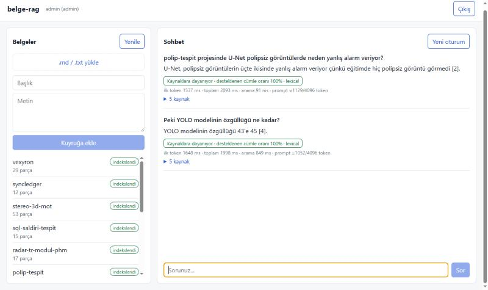
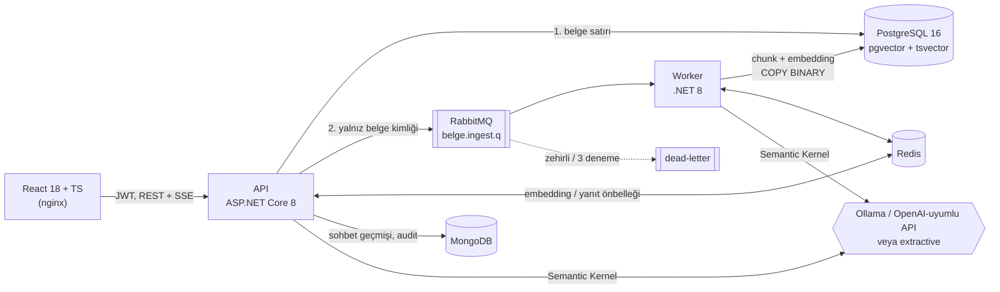

# belge-rag

Belgeler üzerinde kaynak gösteren soru-cevap servisi. Belgeler bir kuyruk üzerinden ayrı bir worker'a gider, parçalanıp PostgreSQL + pgvector'a yazılır; sorular hibrit arama (vektör + tam metin) ve yeniden sıralama ile cevaplanır, yanıt Server-Sent Events ile token token akar. .NET 8 / C# 12, ASP.NET Core Web API ve Semantic Kernel üzerine kurulu.

LLM sağlayıcısı yapılandırmayla seçilir: yerel Ollama, OpenAI-uyumlu herhangi bir API ya da hiç model gerektirmeyen bir çıkarımsal (extractive) temel çizgi. Varsayılan kurulum modelsiz çalışır, bu yüzden `docker compose up` ve testler GPU ya da API anahtarı olmadan da geçer.



*gemma3:4b ile. İlk yanıt doğru. İkinci yanıt (takip sorusu) yanlış: YOLO'nun özgüllüğü 0,74, "43'e 45" ise kaçırılan poliplerin dağılımı. Doğrulayıcı yine de "dayanıyor" diyor, çünkü yanıttaki sözcükler kaynakta geçiyor. Bu sınır aşağıda ölçüldü.*

## Mimari



| Proje | İçerik |
|---|---|
| `src/BelgeRag.Core` | Alan mantığı, altyapıdan bağımsız: chunker, token sayacı, hashing embedding, RRF, reranker, token bütçesi, SK ajanları, orkestratör, ingestion servisi |
| `src/BelgeRag.Infrastructure` | PostgreSQL/pgvector, Redis, MongoDB, RabbitMQ uygulamaları; sağlayıcı seçimi; DI kompozisyonu; sağlık kontrolleri |
| `src/BelgeRag.Api` | Controller'lar, JWT, SSE yazıcı, rate limiting, OpenAPI |
| `src/BelgeRag.Worker` | Kuyruk tüketicisi (generic host) |
| `web/` | React 18 + TypeScript 5 (Vite) istemci |
| `tests/` | xUnit birim testleri ve Testcontainers ile integration testleri |
| `tools/BelgeRag.Eval`, `eval/` | Çalışan sisteme karşı değerlendirme aracı, korpus, sorular, sonuçlar |

### Bir sorunun yolu

1. `POST /api/chat/stream` (JWT, kullanıcı başına dakikada 30 istek). Oturumun son 10 turu MongoDB'den okunur.
2. **Retriever ajanı.** Takip sorusunu bağımsız bir sorguya çevirir (üretken modelde LLM ile, extractive modda kısa sorulara önceki soruyu ekleyen bir sezgiyle). Aramayı bir Semantic Kernel eklentisi (`kb.search_documents`) üzerinden çağırır.
3. **Hibrit arama.** Sorgu embedding'i (önce Redis) alınır; pgvector HNSW kosinüs araması ve `tsvector` tam metin araması paralel koşar. İki sıra Reciprocal Rank Fusion (k=60) ile birleşir, ilk 20 aday sözcüksel bir reranker'dan (BM25 + terim kapsama + yakınlık) geçer.
4. **Token bütçesi.** Pencere (varsayılan 4096) − yanıt payı (512) − %10 tokenizer güvenlik payı − sistem talimatı ve soru. Kalanın en fazla %25'i geçmişe (en yeniden eskiye), sonrası kaynaklara rerank sırasıyla verilir. Sığmayan kaynak, en az 48 token'ı sığıyorsa kesilir, yoksa atılır.
5. `sources` olayı gönderilir. İlk turdaysa yanıt önbelleğine bakılır (anahtar: model + katlanmış sorgu + seçilen chunk kimlikleri).
6. **Cevaplayıcı ajanı** (`ChatCompletionAgent`) yanıtı akıtır, her parça bir `token` olayı olur.
7. **Doğrulayıcı ajanı** her cümlenin kaynaklarda sözcüksel dayanağı olup olmadığını ve atıf numaralarının geçerliliğini ölçer; isteğe bağlı olarak LLM'e de danışır. `verdict` olayı gider.
8. Tur MongoDB'ye, audit kaydı (kullanılan chunk'lar, karar, gecikmeler, prompt token) ayrı koleksiyona yazılır. Bu yazım başarısız olursa akış bozulmaz, uyarı loglanır. Son olay `done`, ölçümleri taşır.

## Ölçümler

Ölçümler çalışan `docker compose` sistemine HTTP üzerinden yapıldı (`tools/BelgeRag.Eval`). Makine: i9-9880H, 32 GB, RTX 2080 (dizüstü), Windows 10 + Docker Desktop. Ham sonuçlar `eval/results/` altında.

**Korpus ve sorular.** Korpus, kendi public portföy depolarımın 12 README'si (175 KB, karışık Türkçe/İngilizce, 327 parça). 48 soruyu belgeleri okuduktan sonra ben yazdım, belge başına 4. Her sorunun yanında belgede birebir geçen bir kanıt ifadesi var. 11 soru çapraz dilli (Türkçe soru, İngilizce belge ya da tersi). Soruları belgeleri bilerek yazdığım için kelime örtüşmesi gerçek kullanıcı sorularından muhtemelen yüksek. Bu durum tam metin aramasını kayırır. Mutlak sayıları bu korpusa özgü okumak gerekir; asıl bilgi yapılandırmalar arası farkta.

Metrikler: **Belge Hit@k**, doğru belgenin ilk k sonuçta olması. **Kanıt@5**, ilk 5 parçadan birinin kanıt ifadesini içermesi; parça düzeyinde, daha katı ölçüt. 48 soruda bir soru 2,1 puan eder. Tam metin aramasında eşit skorların sırası çalıştırmadan çalıştırmaya değiştiği için o satır ±1 soru oynuyor.

### Arama

nomic-embed-text (768 boyut, Ollama, `search_query:` / `search_document:` önekleriyle):

| Yapılandırma | Belge Hit@1 | Belge Hit@5 | MRR@10 | Kanıt@5 | Kanıt@5 aynı dil (37) | Kanıt@5 çapraz dil (11) |
|---|---|---|---|---|---|---|
| Tam metin | 70,8% | 87,5% | 0,790 | 75,0% | 86,5% | 36,4% |
| Vektör | 72,9% | 81,2% | 0,779 | 70,8% | 81,1% | 36,4% |
| Hibrit (RRF) | 75,0% | 89,6% | 0,812 | 75,0% | 86,5% | 36,4% |
| **Hibrit + rerank** | **81,2%** | **93,8%** | **0,865** | **81,2%** | **91,9%** | **45,5%** |

Modelsiz hashing embedding (384 boyut, karakter n-gram):

| Yapılandırma | Belge Hit@1 | Belge Hit@5 | MRR@10 | Kanıt@5 | Kanıt@5 aynı dil | Kanıt@5 çapraz dil |
|---|---|---|---|---|---|---|
| Tam metin | 70,8% | 85,4% | 0,781 | 75,0% | 86,5% | 36,4% |
| Vektör | 72,9% | 83,3% | 0,784 | 75,0% | 86,5% | 36,4% |
| Hibrit (RRF) | 70,8% | 87,5% | 0,787 | 79,2% | 86,5% | 54,5% |
| Hibrit + rerank | 81,2% | 87,5% | 0,849 | 77,1% | 89,2% | 36,4% |

Çıkan sonuçlar:

- **En büyük kazanç reranker'dan geliyor.** İki embedding'de de Hit@1 yaklaşık 10 puan artıyor (70,8–75,0% → 81,2%). Reranker yalnızca ilk 20 aday üzerinde çalışan sözcüksel bir skorlayıcı; model gerektirmiyor.
- **nomic-embed-text tek başına, modelsiz hashing'den iyi değil.** Kanıt@5'te 70,8%'e 75,0%. Bu korpusta sorular belgeye yakın kelimelerle yazıldığı ve çoğu cevap bir sayı ya da tanımlayıcı olduğu için sözcüksel yöntemler güçlü. Gerçek anlamsal katkı, hibrit + rerank satırındaki Belge Hit@5 farkında (93,8% / 87,5%).
- **Görev önekleri ölçülebilir fark yaratıyor.** İlk çalıştırmada nomic'e `search_query:`/`search_document:` önekleri verilmemişti. Önek olmadan vektör Kanıt@5 66,7%, Belge Hit@5 79,2%; önekle 70,8% ve 81,2% (`eval/results/ollama-nomic-noprefix.json`). Önek kullanımı vektör uzayını değiştirdiği için model kimliğine (`nomic-embed-text+prefix`) eklendi; eski vektörlerle karışmıyor.
- **Çapraz dilli sorular zayıf nokta.** En iyi yapılandırmada bile 11 sorudan 5'i. Bulunanlar da çoğunlukla bir sayı ya da tanımlayıcı eşleştiği için bulunuyor. nomic-embed-text ağırlıkla İngilizce eğitilmiş bir model. Çok dilli bir embedding modeli (ör. bge-m3) bir sonraki deney.

Arama gecikmesi (istemci tarafı, p50): tam metin 4,3 ms, hibrit + rerank 11,0 ms. Vektör satırında p50 28,9 ms; bunun çoğu Ollama'ya giden sorgu embedding'i. Aynı sorgular sonraki satırlarda Redis'ten geldiği için hibrit satırı 5,6 ms.

### Sohbet (SSE)

48 soru, her biri iki kez soruldu. İkinci geçiş yanıt önbelleğini ölçüyor. İlk token süresi istemcide, isteğin gönderilmesinden ilk `token` olayına kadar ölçüldü.

| | gemma3:4b (Ollama, GPU) | extractive (modelsiz) |
|---|---|---|
| İlk token p50 / p95 | 864 / 1197 ms | 14 / 18 ms |
| Toplam p50 / p95 | 1437 / 2890 ms | 22 / 32 ms |
| İkinci soruluşta önbellekten | 40 / 48 | 35 / 48 |
| Önbellekten ilk token p50 | 9,5 ms | 12,6 ms |
| Prompt token p50 (o200k sayımı) | 1099 / 4096 | 1102 / 4096 |

Önbellek yalnızca doğrulayıcının "dayanıyor" ya da "kısmen" dediği yanıtları tutuyor. Kalanlar (gemma'da 8, extractive'de 13 "yanıt yok") her seferinde yeniden üretiliyor.

Aynı makinede GPU dizüstü güç/ısı sınırına girdiğinde gemma3'ün ilk token p50'si **6,3 s**'ye çıktı. Bu durumda Ollama'nın kendi ölçümü 1048 token'lık prompt'u 3,1 s'de işliyordu (~335 token/s); GPU 72 °C'de ve 855/2100 MHz'deydi. Servisin payı (arama + bütçe + ilk SSE çerçevesi) iki durumda da yaklaşık 50–100 ms. Yukarıdaki tablo GPU'nun normal durumda olduğu çalıştırmadan.

### Yanıt doğruluğu ve doğrulayıcı

gemma3:4b'nin 48 yanıtını tek tek okuyup etiketledim (`eval/results/manual-judgment-gemma3.json`). Ölçüt: yanıt soruyu belgeye göre doğru ve eksiksiz cevaplıyor mu. Etiketleyen benim; bağımsız bir değerlendirme değil.

| | Sayı |
|---|---|
| Doğru | **35 / 48** |
| Kanıt ilk 5 parçadaysa doğru | 35 / 39 |
| Kanıt ilk 5 parçada değilse doğru | 0 / 9 |

Hataların 9'u aramadan, 4'ü üretimden geliyor. Arama kanıtı getiremediğinde model ya "bilgi yok" diyor ya da ilgisiz bir belgeden yanıt kuruyor. Getirdiğinde ise çoğunlukla doğru cevaplıyor. Yani iyileştirmenin yeri arama.

Sözcüksel doğrulayıcı bu 13 hatanın **5'ini** işaretledi (3'ü modelin "kaynaklarda yok" yanıtlarını `NoAnswer` olarak yakalamak). 35 doğru yanıtın da **5'ine** yanlış alarm verdi. Yanlış alarmların çoğu, İngilizce kaynağa Türkçe verilen doğru yanıtlar ve "%15,1" / "%15.1" gibi biçim farkları. Yani doğrulayıcı şu haliyle bir güvenlik ağı değil, zayıf bir sinyal. Ölçüm sırasında iki hata da bulundu ve düzeltildi: `[1, 2]` biçimindeki atıflar tanınmıyordu, modelin ret cümleleri de "dayanıyor" sayılıyordu. Sonraki adım `Llm:VerifyWithLlm` ile LLM yargıcını açıp aynı etiketlere karşı ölçmek.

Extractive modda ise yanıtlar kaynak cümlelerinin kendisi olduğu için doğrulayıcı tanım gereği hep "dayanıyor" diyor. Bu modun değeri cevap kalitesi değil: hattın tamamını (kuyruk, arama, SSE, önbellek, audit) modelsiz ve deterministik çalıştırması. Yanıtta kanıt ifadesi 26/48.

### Alım

12 belgenin API'ye yazılması 619 ms sürdü. Worker'ın parçalayıp embedding'leyip PostgreSQL'e yazmasıyla birlikte toplam süre hashing ile 1,2 s, nomic-embed-text ile (model bellekteyken) 5,6 s. Model soğukken ilk çalıştırmada ilk iki belgenin embedding'i 53 s sürdü, çünkü Ollama modeli diskten yüklüyordu.

### Testler

| | Sayı | Süre |
|---|---|---|
| xUnit birim testleri | 64 | ~33 s (çoğu o200k tokenizer yüklemesi) |
| Integration testleri (Testcontainers: pgvector, Redis, MongoDB, RabbitMQ) | 16 | ~22 s duvar saati (4 container başlatma dahil; imajlar yerelde) |
| Vitest (SSE ayrıştırıcı) | 3 | <1 s |
| Satır kapsamı, birim + integration birleşik (coverlet) | 88,0% | |

Integration testleri API'yi `WebApplicationFactory` ile, worker'ı ayrı bir generic host olarak aynı süreçte, gerçek container'lara karşı çalıştırıyor. Kapsadıkları: belge yükle → kuyruk → worker → arama → SSE akışı uçtan uca; yetki (401/403) ve doğrulama (400); zehirli mesajın DLQ'ya düşmesi; `to_tsquery` sözdizimi ve SQL enjeksiyonu denemeleri; yeniden indekslemenin chunk'ları çoğaltmaması; embedding boyutu uyuşmazlığında açık hata; Redis isabeti; oturum geçmişinin kullanıcıya göre yalıtımı. Birim testleri kapsayıcıyı `ValidateOnBuild` + `ValidateScopes` ile kuruyor ve yaşam döngülerini tek tek doğruluyor.

## Tasarım kararları

**Servis yaşam döngüleri.**
- **Singleton:** iş parçacığı güvenli, kurulumu pahalı ve paylaşılması gereken her şey. Bağlantı havuzları (`NpgsqlDataSource`, `IConnectionMultiplexer`, `IMongoClient`, tek AMQP bağlantısı), tokenizer, embedding istemcisi ve durumsuz algoritmalar (chunker, bütçeleyici, skorlayıcı) bu gruptadır.
- **Scoped:** bir HTTP isteği ya da bir kuyruk mesajı ölçeğindeki iş birimi. Depolar, arama, ajanlar ve orkestratör bu gruptadır. Worker `BackgroundService` olduğu için singleton'dır. Scoped servis enjekte etmez; her mesaj için `IServiceScopeFactory` ile yeni kapsam açar.
- **Transient:** Semantic Kernel `Kernel`. Retriever ajanı kernel'e eklenti yüklüyor; kernel paylaşılsaydı eklentiler istekler arasında sızardı.
- Captive dependency hatası açılışta `ValidateScopes`/`ValidateOnBuild` ile yakalanıyor.

**Kuyruk.**
- Mesaj yalnızca belge kimliğini taşır, içerik PostgreSQL'dedir. API önce satırı yazar, sonra yayınlar; böylece worker mesajı hemen alsa da satır hazırdır.
- Yayıncı onayı (publisher confirms) açıktır. Mesajlar kalıcıdır, `prefetch=8` ve manuel ack kullanılır.
- Hata durumunda mesaj `x-retry` başlığı artırılarak yeniden yayınlanır. Deneme hakkı bitince belge `failed` işaretlenir ve mesaj DLQ'ya gider. Çözümlenemeyen mesaj doğrudan DLQ'ya gider.
- İndeksleme idempotenttir: chunk'lar tek transaction'da sil-ve-yaz ile değiştirilir, yeniden teslim çoğaltma yapmaz.

**Tam metin araması ve Türkçe.**
- PostgreSQL'in `simple` yapılandırması "İ/ı" ve diğer Türkçe harfleri katlamaz. Bu yüzden `search_text` sütunu C# tarafında katlanarak (`TextFolding`) yazılır, sorgu da aynı katlamayla kurulur.
- Ekleri yakalamak için terimler 6 karakterlik kök önekine kısaltılıp önek eşleşmesiyle (`katman:*`) aranır.
- Kullanıcı girdisi `to_tsquery`'ye yalnızca harf/rakam önekleri olarak ulaşır.
- Bu katlamanın gerekli olduğunu `hakem` projesinde yaşanan bir hata da gösteriyor: Türkçe küçük harfe çevirme "Introduction"ı "ıntroduction" yapmıştı.

**Önbellek.**
- Embedding önbelleğinin anahtarı model + amaç (sorgu/belge) + SHA-256(metin), TTL 7 gündür. Toplu isteklerde tek MGET kullanılır.
- Yanıt önbelleği yalnızca ilk turda ve yalnızca dayanaklı yanıtlar için çalışır; anahtarda seçilen chunk kimlikleri vardır, TTL 6 saattir. Belge eklenince arama farklı chunk'lar seçer ve eski yanıt kendiliğinden devre dışı kalır.
- Redis erişilemezse iki önbellek de atlanır. Önbellek bir optimizasyon, bağımlılık değil.

**SSE.**
- .NET 8'de yerleşik SSE sonucu olmadığı için yanıt gövdesine elle yazılıyor: tamponlama kapatılıyor ve her olaydan sonra flush ediliyor. nginx'te `proxy_buffering off` ve `X-Accel-Buffering: no` ayarlı.
- Tarayıcının `EventSource`'u POST ve `Authorization` başlığı desteklemediği için istemci akışı `fetch` + `ReadableStream` ile kendisi ayrıştırıyor.
- Başlıklar gönderildikten sonra oluşan hata, durum kodu yerine `error` olayıyla bildiriliyor.

**Kimlik.**
- JWT HS256, rol tabanlı yetki: belge eklemek `admin`, sohbet ve arama her kimliği doğrulanmış kullanıcı içindir.
- Demo kullanıcılar yapılandırmadan gelir ve gerçek bir kimlik sağlayıcısının yerini tutar. Parola karşılaştırması sabit zamanlıdır, kullanıcı yoksa da yapılır.
- Sohbet geçmişi (kullanıcı, oturum) çiftiyle sorgulanır; başkasının oturum kimliğini bilen o geçmişi okuyamaz.

## Çalıştırma

Modelsiz (varsayılan, hashing embedding + extractive):

```bash
docker compose up --build
```

- Arayüz: http://localhost:8080 (kullanıcılar `admin` / `admin-demo` ve `demo` / `demo-demo`)
- API ve Swagger: http://localhost:8081/swagger
- RabbitMQ yönetim paneli: http://localhost:15672

Ana makinedeki Ollama ile. Embedding boyutu 384'ten 768'e değiştiği için veritabanı sıfırlanmalı:

```bash
ollama pull gemma3:4b
```

```bash
ollama pull nomic-embed-text
```

```bash
docker compose down -v
```

```bash
docker compose -f docker-compose.yml -f docker-compose.ollama.yml up --build
```

OpenAI-uyumlu bir API için `LLM_PROVIDER=OpenAI`, `LLM_ENDPOINT`, `LLM_API_KEY`, `LLM_CHAT_MODEL` ortam değişkenleri yeterli. Embedding için `EMBEDDINGS_*` değişkenleri aynı şekilde çalışır.

Testler (Docker çalışıyor olmalı):

```bash
dotnet test
```

```bash
cd web && npm ci && npm test
```

Değerlendirme, çalışan sisteme karşı (`eval/results/<label>.json` üretir):

```bash
CHAT_RATE_LIMIT_PER_MINUTE=1000 docker compose up -d --wait
```

```bash
dotnet run --project tools/BelgeRag.Eval -c Release -- --label deneme
```

## CI

`.github/workflows/ci.yml` üç iş çalıştırır:

1. **.NET:** derleme, birim ve integration testleri (GitHub runner'ında Docker olduğu için Testcontainers çalışır), opencover kapsam raporu. `SONAR_TOKEN` secret'ı tanımlıysa SonarCloud analizi de bu işte yapılır.
2. **Web:** typecheck, Vitest, build.
3. **Compose:** `docker compose up --wait` ve ardından `scripts/smoke.sh` ile uçtan uca duman testi.

SonarCloud tarafında proje anahtarı ve organizasyon `SONAR_PROJECT_KEY` / `SONAR_ORGANIZATION` değişkenleriyle değiştirilebilir. SonarCloud analizi henüz bu depoda çalıştırılmadı; token tanımlanınca çalışacak.

## Sınırlar

- Değerlendirme küçük (48 soru, 12 belge) ve soruları belgeleri bilen biri yazdı. Yapılandırmalar arası 2–4 puanlık farklar bir-iki soruya denk geliyor; güven aralığı verecek kadar örnek yok.
- Doğrulayıcı sözcüksel çalışıyor: anlam düzeyinde çıkarım yapmıyor, çapraz dilde yanlış alarm veriyor, sayısal yanlışları kaçırıyor (yukarıdaki ekran görüntüsü). LLM yargıç modu kodda var ama ölçülmedi.
- Token sayımı o200k tokenizer ile yapılıyor; Gemma'nın tokenizer'ı farklı, bu yüzden bütçede %10 pay var. Pencere boyutu, Ollama'nın `num_ctx`'i ile elle eşit tutulmalı (bu çalıştırmada ikisi de 4096).
- Reranker sözcüksel. Cross-encoder bir reranker ile karşılaştırılmadı.
- Kimlik doğrulama demo düzeyinde: kullanıcılar yapılandırmada, refresh token yok.
- Embedding modeli değiştirilirse eski belgeler otomatik yeniden indekslenmiyor; vektör araması yalnızca etkin modelin chunk'larına bakıyor, belgelerin yeniden yüklenmesi gerekiyor.

## Lisans

MIT. `eval/corpus/` altındaki README'ler kendi depolarımdan alındı ve kendi lisanslarına tabi.
